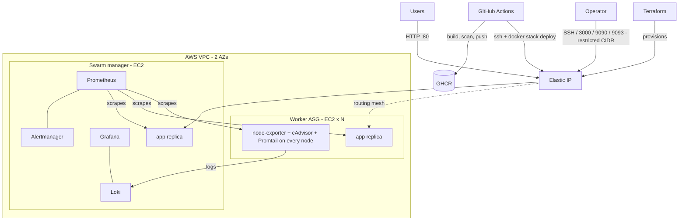

# Ticket Resolution Platform: Infrastructure Automation & Observability

A DevOps project that takes an existing AI application (a RAG-based IT-ticket resolution
service) and builds everything around it: **Terraform** provisions the cloud
infrastructure, **Docker Swarm** orchestrates the containers, and a full
**Prometheus / Grafana / Loki / Alertmanager** stack provides observability. A CI/CD
pipeline builds, scans, tests and deploys it.

> **Attribution.** The application in [`app/`](app/) was written by
> [kishoredhondhu](https://github.com/kishoredhondhu/ai-ticket-resolution-system) and is used
> unmodified (upstream commit `049f3ef`) under its MIT licence. It is the *workload*.
> Everything outside `app/` is the DevOps work of this project. See [ATTRIBUTION.md](ATTRIBUTION.md).

---

## What is in here

| Area | Where | What it does |
|---|---|---|
| Infrastructure as Code | [`terraform/`](terraform/) | VPC, subnets, security groups, IAM, Elastic IP, Swarm manager (EC2) and self-healing worker Auto Scaling Group. Nodes bootstrap themselves into a Swarm using SSM Parameter Store. |
| Container image | [`docker/`](docker/) | Multi-stage build (Node build → slim Python runtime), non-root user, health check, secret-aware entrypoint. |
| Orchestration | [`docker-stack.yml`](docker-stack.yml) | One Swarm stack: app (2 replicas, rolling updates with auto-rollback) + 9 observability services. |
| Observability | [`observability/`](observability/) | Prometheus (+ alert rules), Alertmanager, Grafana (provisioned datasources and dashboard), Loki + Promtail, Blackbox, JSON exporter, node-exporter, cAdvisor. |
| CI/CD | [`.github/workflows/`](.github/workflows/) | Lint → test → build → vulnerability scan → push to GHCR → deploy over SSH → smoke test. Separate Terraform plan/apply workflow using OIDC (no stored AWS keys). |
| Automation | [`scripts/`](scripts/), [`Makefile`](Makefile) | `deploy.sh`, local single-node Swarm, smoke test, load generator, offline validator. |
| Documentation | [`docs/`](docs/) | Architecture, deployment guide, observability guide, runbook, project report. |

## Architecture at a glance



Details: [docs/ARCHITECTURE.md](docs/ARCHITECTURE.md).

## Quick start

### A. Run everything locally (no cloud account needed)

Requires Docker with the Compose/Swarm CLI.

```bash
./scripts/local-up.sh            # builds the image, starts a single-node swarm, deploys, smoke-tests
./scripts/load-test.sh http://localhost:8080 100   # fill the dashboards with traffic
open http://localhost:3000       # Grafana (admin / password printed by local-up)
./scripts/local-down.sh --purge  # clean up
```

### B. Deploy to AWS

```bash
cd terraform
cp terraform.tfvars.example terraform.tfvars   # set admin_cidrs to YOUR_IP/32
terraform init && terraform apply

# deploy the stack (image is built and pushed by CI; or build/push your own)
cd ..
APP_IMAGE=ghcr.io/<you>/ticket-resolution:latest make deploy
make cloud-smoke
terraform -chdir=terraform destroy      # when finished: stops all charges
```

Full walkthrough, CI/CD variables and secrets: [docs/DEPLOYMENT.md](docs/DEPLOYMENT.md).

## Key design decisions

- **No application changes.** The app exposes JSON metrics, not Prometheus format, so a
  JSON exporter translates `/api/metrics*` and a Blackbox exporter probes `/health` per replica.
- **Swarm DNS service discovery.** Prometheus uses `tasks.<service>` DNS so every replica and node is monitored automatically as the cluster scales.
- **Zero-downtime deploys.** `order: start-first`, health-gated, automatic rollback on failure.
- **Config as immutable versions.** Swarm configs are named with a content hash, so editing a dashboard or alert rule and redeploying rolls the change out safely.
- **Secrets never in Git or state.** Swarm secrets for runtime values, SSM Parameter Store for join tokens, GitHub OIDC for AWS access.
- **Guard rails.** Terraform rejects `0.0.0.0/0` for admin ports; IMDSv2 required; encrypted volumes; manager protected from accidental replacement.

## Verification status

Be explicit about what has and has not been run:

| Check | Status |
|---|---|
| YAML / JSON / shell syntax, stack ↔ Prometheus consistency (`scripts/validate.sh`) | Passed |
| `terraform validate`, `docker build`, `docker stack deploy`, live cloud deployment | **Not run during authoring** (no Docker daemon / Terraform / cloud access in the authoring environment). Run `make validate`, `./scripts/local-up.sh` and `terraform plan` first. CI performs all of these on push. |

Run `terraform fmt -recursive` once (the CI format check is strict). Expect to fix small issues on first run (typical for any new infrastructure code); the
[runbook](docs/RUNBOOK.md) lists the likely ones.

## Repository layout

```
app/                    upstream application (unmodified snapshot, MIT)
docker/                 Dockerfile + entrypoint
docker-stack.yml        Swarm stack definition
observability/          Prometheus, Alertmanager, Grafana, Loki, Promtail, exporters
terraform/              AWS infrastructure (+ bootstrap-state for remote state)
scripts/                deploy, local-up/down, smoke-test, load-test, validate
.github/workflows/      ci.yml, deploy.yml, terraform.yml
docs/                   architecture, deployment, observability, runbook, report
```
