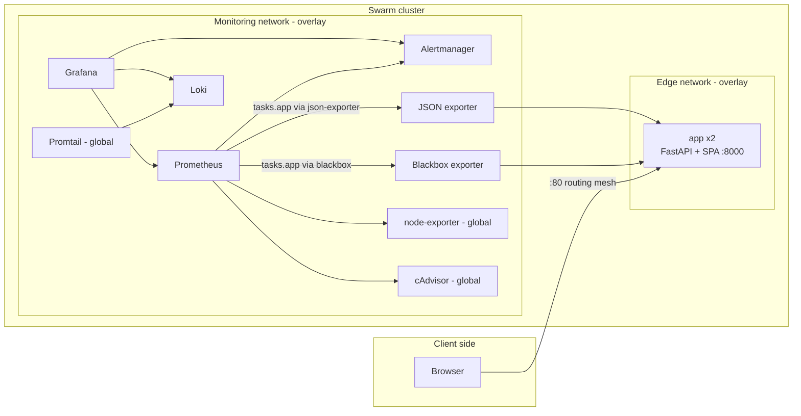
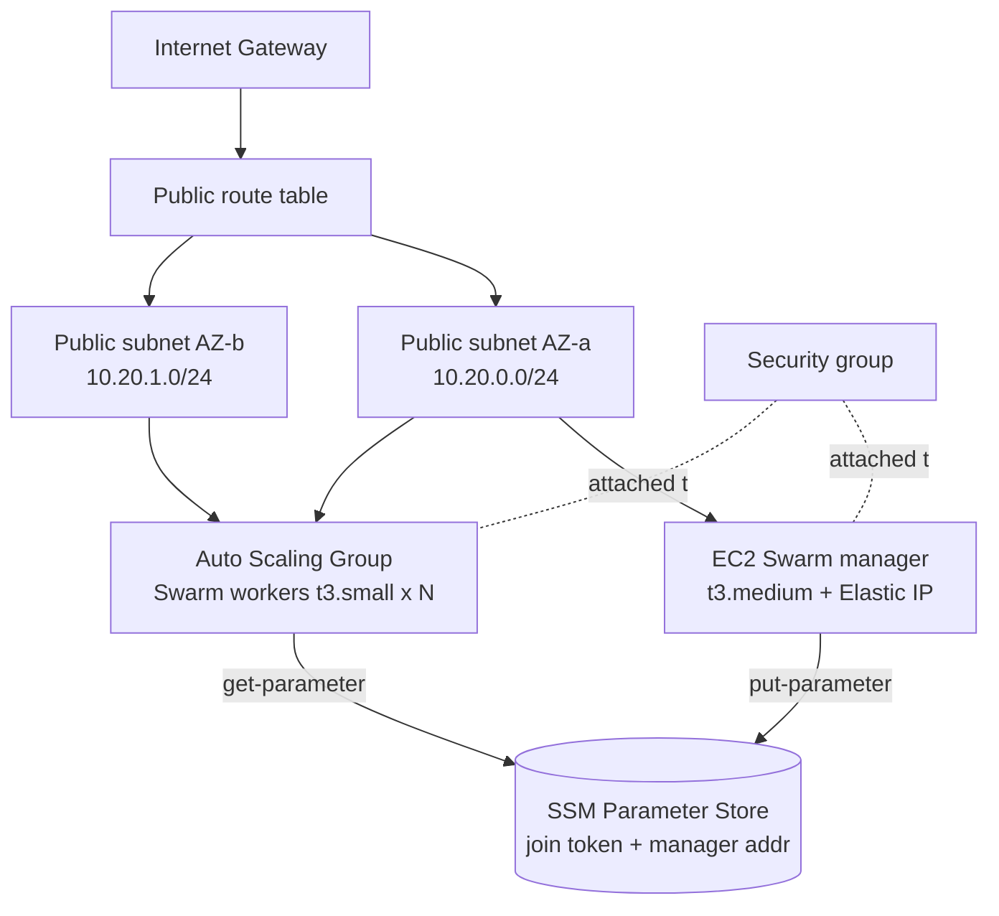

# Architecture

## 1. Overview

The workload is a single-container web service: FastAPI serves a TF-IDF retrieval (RAG)
API **and** the built React single-page app. It keeps its knowledge base in a pickle file
baked into the image and optionally calls Hugging Face for AI refinement. That makes it
stateless from an operations point of view, which suits a simple, robust Swarm design.

## 2. Infrastructure (Terraform)

| Resource | File | Notes |
|---|---|---|
| VPC, 2 public subnets, IGW, routes | `network.tf` | `/16` split into `/24`s across 2 AZs. No NAT gateway (cost). |
| Security group + rules | `security.tf` | Swarm ports only between members (self-reference); port 80 public; 22/3000/9090/9093 only from `admin_cidrs`. |
| IAM roles/profiles, SSM parameters | `iam.tf` | Manager can write, workers can only read `/<project>/<env>/swarm/*`. SSM Session Manager enabled. |
| Manager instance + Elastic IP | `compute.tf` | IMDSv2 only, encrypted gp3, `ignore_changes = [ami, user_data]` so it is never replaced implicitly. |
| Worker launch template + ASG | `compute.tf` | Self-healing; rolling instance refresh on template change. |
| Node bootstrap | `templates/*.tftpl` | Installs Docker + AWS CLI; manager runs `swarm init`; workers poll SSM then `swarm join`. |

### How the cluster forms without manual steps

1. Terraform creates two SSM parameters with the placeholder `pending`.
2. The manager boots, installs Docker, runs `docker swarm init`, and overwrites the parameters with the worker join token and its private `ip:2377`.
3. Each worker boots, polls SSM every 10 s (up to 15 min), and runs `docker swarm join` as soon as real values appear. Boot order therefore does not matter, and a replacement worker created by the ASG joins by itself.

## 3. Orchestration (Docker Swarm)

| Concern | Approach |
|---|---|
| Ingress | Swarm routing mesh publishes port 80 on every node; the Elastic IP points at the manager, but any node answers. |
| Rollouts | `update_config: order: start-first, parallelism: 1, failure_action: rollback, monitor: 30s`. A new task must pass its health check before an old one stops. |
| Health | Container `HEALTHCHECK` on `/health`, which returns 503 until the knowledge base is loaded. |
| Placement | App spread across nodes (`spread: node.id`, `max_replicas_per_node: 2`). Stateful monitoring services pinned to the manager. |
| Resource limits | Every service has a memory limit; the app also has CPU limit/reservation. |
| Config & secrets | Swarm configs (content-hash named) for all observability files; Swarm secrets for the Grafana password and Hugging Face token. |
| Networks | `edge` (app only) and `monitoring` (observability + app) overlay networks. |
| Log rotation | json-file driver, 10 MB × 3 files, set in stack and daemon. |

## 4. CI/CD flow

```mermaid
graph LR
    PR[Pull request] --> L[Lint + validate<br/>shellcheck, hadolint, tflint, terraform validate]
    L --> T[App tests<br/>vitest + KB load check]
    T --> B[Build image]
    B --> S[Trivy scan + container smoke test]
    S -->|merge to main| P[Push to GHCR]
    P --> D[Deploy job<br/>environment: production]
    D --> O[OIDC to AWS<br/>open SSH for runner IP only]
    O --> W[ssh docker stack deploy]
    W --> K[Smoke test, close SSH]
```

Notable choices:

- **OIDC federation** to AWS instead of long-lived access keys.
- **Just-in-time SSH:** the runner's IP is added to the security group for the duration of the deploy and removed in an `always()` step.
- **Rollback** is a deploy of an earlier image tag (manual workflow input), plus Swarm's automatic rollback if a rollout fails health checks.

## 5. Security model

| Layer | Control |
|---|---|
| Network | Admin ports restricted to operator CIDR; Terraform validation rejects `0.0.0.0/0`; Swarm control/data-plane ports only between nodes. |
| Host | IMDSv2 required, encrypted EBS, SSM Session Manager available (SSH optional), Docker log rotation. |
| Container | Non-root user (uid 10001), slim base, read-only secret mounts, resource limits. |
| Secrets | Swarm secrets (encrypted at rest in Raft), SSM SecureString for tokens, no secrets in Git, images or Terraform state. |
| Supply chain | Trivy scan fails the build on fixable CRITICAL vulnerabilities; pinned image versions for all third-party services. |
| CI | OIDC, environment approval gates, least-privilege roles (recommended policy in DEPLOYMENT.md). |

## 6. Known limitations and upgrade path

These are deliberate trade-offs for a cost-conscious project; each has a clear next step.

| Limitation | Why | Upgrade |
|---|---|---|
| Single manager | Simple, cheap; Swarm control plane is a single point of failure. | 3 managers across AZs (odd number for Raft quorum). |
| Public subnets, no NAT | Avoids ~$30+/month NAT cost. | Private subnets + NAT or VPC endpoints; ALB/WAF in front. |
| Plain HTTP | No domain assumed. | ALB + ACM certificate, or Traefik with Let's Encrypt. |
| Monitoring data on manager's root volume | Keeps Terraform simple. | Dedicated EBS volume, or Thanos/Mimir + S3 and Loki on S3. |
| App metrics are in-memory per replica | Upstream design (`metrics_tracker`); counters reset on restart. | Instrument the app with `prometheus-client` (histograms, request counters). Dashboards already label by `instance`. |
| Upstream CORS is `*` | App code, out of scope. | Restrict origins in the application. |
| node-exporter runs in a container network | Swarm cannot use `network_mode: host`. | CPU, memory and disk are host-accurate; network metrics reflect the container. Use an AMI-level exporter if needed. |
| Alert notifications not wired | Needs a webhook/SMTP the operator owns. | Uncomment a receiver in `alertmanager.yml`. |

## 7. Why Docker Swarm (and not Kubernetes)

Swarm was a requirement for this project, and it is a defensible choice here: one
stateless service plus a handful of supporting tools does not need Kubernetes' API
surface. Swarm gives rolling updates, health-gated rollouts, secrets, configs, service
discovery and a routing mesh with a fraction of the operational cost. The same container
image, health endpoints and observability stack port directly to Kubernetes if the
workload grows.
