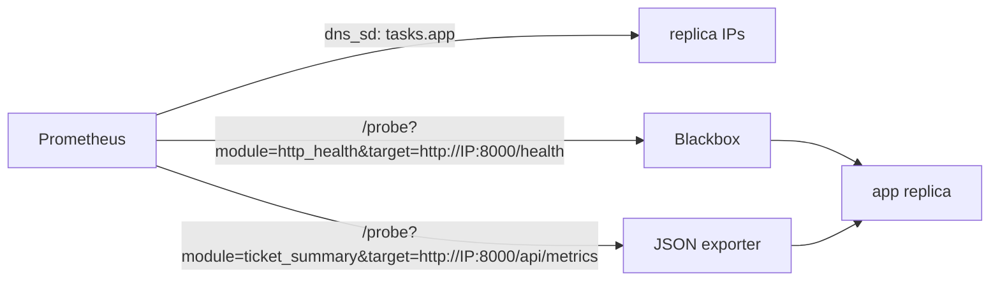

# Observability guide

Three signals are covered: **metrics** (Prometheus), **logs** (Loki) and **alerts**
(Prometheus rules → Alertmanager), all visualised in Grafana.

## 1. Components

| Service | Image | Role |
|---|---|---|
| prometheus | `prom/prometheus:v2.53.0` | Scrapes and stores metrics (15-day retention), evaluates alert rules. |
| alertmanager | `prom/alertmanager:v0.27.0` | Groups, de-duplicates, inhibits and routes alerts. |
| blackbox | `prom/blackbox-exporter:v0.25.0` | Probes `/health` (end-to-end and per replica). |
| json-exporter | `prometheuscommunity/json-exporter:v0.6.0` | Turns the app's JSON metrics endpoints into Prometheus metrics. |
| node-exporter (global) | `prom/node-exporter:v1.8.1` | Host CPU, memory, disk, load per node. |
| cadvisor (global) | `gcr.io/cadvisor/cadvisor:v0.49.1` | Per-container CPU, memory, restarts. |
| loki | `grafana/loki:2.9.8` | Log store (7-day retention). |
| promtail (global) | `grafana/promtail:2.9.8` | Ships container logs with Swarm labels. |
| grafana | `grafana/grafana:10.4.5` | Dashboards; datasources and dashboard are provisioned from files. |

## 2. How the app is monitored without changing it

The upstream app has no Prometheus endpoint. Two exporters bridge the gap:



Swarm's DNS name `tasks.app` returns the IP of every running replica, so Prometheus
discovers replicas automatically. Relabelling rewrites each discovered address into the
exporter's `target` parameter and keeps the replica IP as the `instance` label. Because the
upstream metrics are held in memory **per replica**, scraping each replica separately (not
through the load-balanced VIP) is what makes the numbers correct.

## 3. Metrics reference

### Application (via JSON exporter, per replica)

| Metric | Source field | Meaning |
|---|---|---|
| `ticket_queries_total` | `/api/metrics` `total_queries` | Queries served since the replica started (counter). |
| `ticket_success_ratio` | `/api/metrics` `success_rate` | Fraction successful (0 when idle). |
| `ticket_recent_queries` | `/api/metrics/realtime` `recent_queries` | Size of the rolling window (≤ 100). |
| `ticket_recent_avg_response_ms` | `/api/metrics/realtime` `avg_response_time` | Mean latency over the window, **milliseconds**. |
| `ticket_recent_avg_confidence` | `/api/metrics/realtime` `avg_confidence` | Mean RAG similarity/confidence (0–1). |

Only fields that are present even when the app is idle are mapped, so scrapes do not
fail on a freshly started replica.

### Availability (Blackbox)

`probe_success`, `probe_duration_seconds`, `probe_http_status_code` for two jobs:
`app-health-service` (through the VIP, what users experience) and `app-health-tasks`
(each replica).

### Infrastructure

`node_*` (CPU, memory, filesystem, load) from node-exporter and `container_*`
from cAdvisor.

## 4. Alert rules

Defined in [`observability/prometheus/alerts.yml`](../observability/prometheus/alerts.yml).

| Alert | Condition | For | Severity |
|---|---|---|---|
| AppDown | VIP health probe fails | 2 m | critical |
| AppReplicaUnhealthy | a replica's health probe fails | 3 m | warning |
| AppReplicasDegraded | fewer than 2 healthy replicas | 5 m | warning |
| AppSlowHealthCheck | probe latency > 1 s | 10 m | warning |
| ScrapeTargetDown | any `up == 0` | 5 m | warning |
| AppLowSuccessRate | success ratio < 90 % (with > 20 queries) | 10 m | warning |
| AppLowConfidence | avg confidence < 0.3 (window > 20) | 15 m | info |
| AppSlowResponses | avg latency > 3000 ms (window > 20) | 10 m | warning |
| NodeHighCPU / NodeHighMemory | > 85 % / > 90 % | 10 m | warning |
| NodeDiskLow | < 15 % free on `/` | 10 m | critical |
| ContainerHighMemory | > 90 % of limit | 5 m | warning |
| ContainerRestarting | > 2 restarts in 15 m | | warning |

`AppReplicasDegraded` assumes the default of 2 replicas; change the threshold if you
scale differently. A `critical` alert inhibits the `warning` of the same name on the same
instance. To receive notifications, enable a receiver in `observability/alertmanager/alertmanager.yml`
and redeploy.

## 5. Dashboard

**Ticket Resolution System - Overview** (auto-provisioned, home dashboard):

| Section | Panels |
|---|---|
| Service health | availability, healthy replicas, nodes up, queries served, success rate, firing alerts |
| Application | queries/min by replica, avg response time, avg confidence, probe latency |
| Infrastructure | CPU %, memory %, root disk % per node |
| Containers | CPU and memory per container |
| Logs | error lines per service, live stack logs |

Dashboards are files in Git (`observability/grafana/dashboards/`); `allowUiUpdates: false`
makes Git the single source of truth. To change one: edit it in a scratch Grafana,
export the JSON, replace the file, redeploy.

## 6. Logs

Promtail discovers containers through the Docker socket on every node and attaches the labels
`service`, `stack`, `container`, `node_id` and a parsed `level`. Example LogQL queries
(Grafana → Explore → Loki):

```logql
{stack="ticket", service="ticket_app"}                         # app logs
{stack="ticket"} |= "Error suggesting resolution"              # specific error
sum by (service) (count_over_time({stack="ticket", level="ERROR"}[5m]))
```

## 7. Useful PromQL

```promql
sum(rate(ticket_queries_total[5m])) * 60                 # total queries/min
sum(probe_success{job="app-health-tasks"})                # healthy replicas
topk(5, sum by (name) (rate(container_cpu_usage_seconds_total{name!=""}[5m])))
```

## 8. Limits to be aware of (and mention in the viva)

- **Upstream metrics are minimal and in-memory.** Counters reset on restart; no latency histograms, so no p95/p99 SLO. The upgrade is to instrument the app (`prometheus-client` / `prometheus-fastapi-instrumentator`); the Prometheus side then scrapes `/metrics` directly and the JSON exporter can be removed.
- **Response time unit** is milliseconds in the app; metric names say so.
- **node-exporter network metrics** describe the container's network namespace, not the host's.
- **Retention is local disk.** 15 days of metrics and 7 days of logs on the manager's volume; use remote storage for long-term retention.
